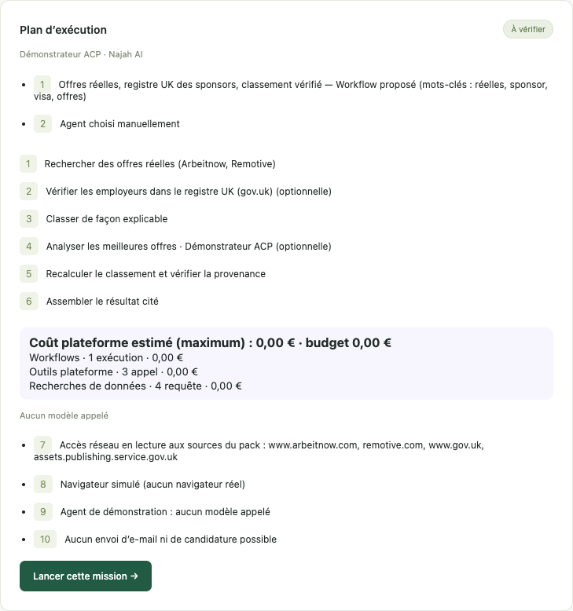
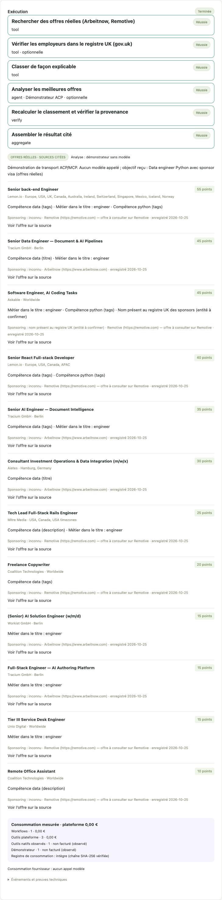
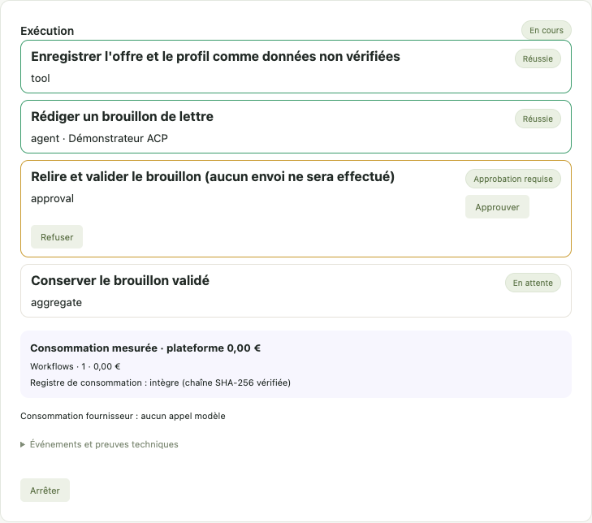

# Relay · Agent Platform

Prototype local d'agrégation d'agents CLI. Interface française, sessions ACP, Skills portables, outils MCP et Domain Pack Najah indépendant. **MVP local mono-utilisateur, pas une plateforme SaaS prête à commercialiser.**

## Démarrer

Prérequis : Node.js **24+**, npm, macOS/Linux pour les groupes de processus. Windows non validé.

```sh
npm ci --ignore-scripts
npm start
```

Ouvrir **http://127.0.0.1:4310**. Si ce port est déjà occupé (`EADDRINUSE`), conserver le serveur existant ou démarrer avec `PORT=4311 npm start`, puis ouvrir http://127.0.0.1:4311. `PORT=0 npm start` choisit un port libre et affiche son URL. Les adaptateurs optionnels sont installés par npm, sans scripts d'installation. Si un paquet optionnel manque, le démonstrateur reste utilisable ; `npm run doctor` précise la présence des CLI/adaptateurs.

1. Installer les deux Skills proposés dans l'interface ; ils sont activés puis sélectionnables.
2. Conserver **Démonstrateur ACP**, saisir par exemple « Rechercher des offres d'emploi Python et SQL en Australie ».
3. Préparer la mission, consulter étapes/permissions/coût, puis lancer.
4. Lire les trois offres **fictives**, les scores, les événements et l'historique.

Aucun compte ou jeton nécessaire. La source `jobs.example.test` n'est jamais contactée. Le démonstrateur n'appelle aucun modèle. **ACP et MCP utilisent de vrais échanges entre processus**, tandis que l'agent et le navigateur sont déterministes.

## Agents réels BYOA

Installer et authentifier son CLI avec les outils du fournisseur. Les CLI installés hors du PATH (par exemple
Gemini CLI et OpenCode dans un dossier dédié) se déclarent dans `.data/agents.json` (non versionné, chemins
absolus) :

```json
{ "cliDirs": ["/chemin/absolu/vers/node_modules/.bin"], "paths": { "gemini": "/chemin/absolu/gemini" } }
```

`AGENT_PLATFORM_CLI_DIRS=/dir1:/dir2` est équivalent. Chaque agent reçoit un **environnement en liste blanche**
(variables système de base + variables de son profil, par exemple `GEMINI_API_KEY` pour Gemini seulement).
Les modes sûrs sont imposés à partir des modes annoncés : Codex `read-only`, Claude `default`, Gemini `default`,
OpenCode `plan` ; sans mode sûr annoncé, le run est refusé. Le mode **Auto** choisit l'agent disponible selon
les exigences (reprise, modèle, transport MCP) et les derniers tests, et explique son choix dans le plan.

```sh
npm run doctor                   # détection et compatibilité ACP, sans session ni prompt
AGENT_PLATFORM_LIVE=1 npm start   # interface avec agents réels, aucun appel modèle au démarrage
```

Les modèles proposés dans l'interface sont ceux annoncés au dernier test (`.data/agent-probes.json`).
Les modèles gratuits d'OpenCode refusent d'être utilisés comme moteur d'un autre service (ADR 005).

Les commandes suivantes restent optionnelles et distinctes des démarrages vérifiés.
Le diagnostic avancé `npm run test:live` effectue un handshake et une session fournisseur, sans prompt par
défaut. Il est séparé des tests courants et n'a pas été relancé au sprint 09. Activer `LIVE_PROMPT=1`
déclenche une inférence et consomme le compte utilisateur ; choisir volontairement l'agent (`LIVE_AGENTS`)
et un modèle réellement annoncé (`LIVE_MODEL`). Les scripts `scripts/live-run.js` et `scripts/live-resume.js`
sont également des opérations réelles, à exécuter séparément avec le budget et les accès nécessaires.

Le serveur sélectionne les **CLI utilisateur hors node_modules**. Le chemin est fixé via `CODEX_PATH` / `CLAUDE_CODE_EXECUTABLE` pour les adaptateurs upstream. Aucun changement d'authentification n'est effectué. La détection n'est pas une garantie d'authentification : le handshake réel et le prompt restent décisifs.

Codex est placé en mode ACP `read-only`, Claude en `default`, si ces modes sont annoncés ; sinon le run échoue. Les demandes de permission ACP sont affichées pour décision ponctuelle, expirent après 60 s et sont annulées avec le run. Les capacités fs/terminal du client sont désactivées. **Cela ne constitue pas une isolation OS** des outils natifs/hooks/configurations du CLI : n'exposer ce serveur ni à Internet ni à des utilisateurs/tâches non fiables. Aucun outil d'e-mail ou de candidature n'est fourni.

Le champ modèle accepte uniquement un identifiant annoncé par la session (`configOptions` ou `models`, selon le runtime). Laisser vide pour le défaut fournisseur ; les options annoncées apparaissent dans les événements de session et le rapport `docs/research/live-probe.json`. Pas de modèle ou de prix inventé.

La reprise crée un nouveau run lié au même identifiant fournisseur/cwd, seulement lorsque `loadSession` est annoncé. Elle est disponible dans l'interface pour les runs terminés/interrompus compatibles. La reprise de session agent ne garantit pas une reprise transactionnelle des effets natifs du CLI. La reprise durable des étapes concerne le mode Workflow DAG décrit plus bas. Sans cette capacité, relancer une nouvelle mission.

## Navigateur (Browser Gateway)

Les outils MCP navigateur fournis aux agents exposent des capacités typées (`browser_navigate`, `browser_snapshot`,
`browser_extract`, `browser_click`, `browser_type`, `browser_upload`, `browser_download`) contrôlées par la
gateway : domaines autorisés du pack, HTTPS, anti-SSRF, redirections revérifiées, fichiers confinés au
dossier du run. Toute action d'écriture demande une décision dans l'interface ; les actions sensibles
(postuler, envoyer, payer, mot de passe, fichier) la demandent toujours. Aucun script arbitraire n'est exposé.

```sh
AGENT_PLATFORM_BROWSER=fixture npm start                    # défaut : sans réseau ni navigateur
AGENT_PLATFORM_BROWSER=isolated AGENT_PLATFORM_CHROME_PATH="/Applications/Google Chrome.app/Contents/MacOS/Google Chrome" AGENT_PLATFORM_LIVE=1 npm start
AGENT_PLATFORM_BROWSER=playwriter AGENT_PLATFORM_LIVE=1 npm start   # relais Playwriter local (extension requise)
```

Le démarrage `isolated` ou `playwriter` est paresseux : il ne lance/connecte le navigateur qu'au premier
outil navigateur. Les trois commandes ci-dessus démarrent l'API ; la commande Playwriter ne prouve pas la
présence du relais ou de l'extension. Le contrôle docs-01 a revérifié le démarrage et les réponses HTTP des trois
modes sur des ports libres ; voir les sorties brutes dans [.manager/reports/docs-01.md](.manager/reports/docs-01.md).
Cela ne déclenche pas la connexion navigateur différée.
**En mode sécurisé, l'extension Playwriter 0.7.0 est incompatible avec les protections requises : connexion refusée avant
attachement aux onglets**, même avec consentement partagé. Le relais ne crée pas de contexte isolé et
refuse la session CDP par onglet de Playwright. Le fallback routage/CSP est supprimé : un service worker
existant peut le contourner. Utiliser le mode `isolated`. Preuves :
[rapport playwriter-01](.manager/reports/playwriter-01.md).

Par défaut, JavaScript est désactivé et le contexte utilisateur n'est pas partagé, même via CDP.
`AGENT_PLATFORM_BROWSER_JAVASCRIPT=1` demande JavaScript ;
`AGENT_PLATFORM_BROWSER_SHARED_CONTEXT=1` demande le contexte utilisateur (mode `playwriter` seulement).
Chaque option nécessite ensuite son propre consentement humain enregistré pour le run, avant toute
ouverture. Un refus, une annulation ou l'absence de pont empêche l'activation. Le consentement n'est pas
transférable à un autre run. **Le canal de décision HTTP local n'authentifie pas une personne** : un
programme natif du même compte peut l'appeler sans Origin et approuver lui-même. Ce mécanisme protège
les appels MCP et les requêtes de pages, mais la résistance à un CLI hostile reste **incomplète**.
Les risques scripts/cookies et limites du contexte partagé sont dans l'ADR 006.

Avec Playwriter, désactiver sa télémétrie (`PLAYWRITER_TELEMETRY=0`). Vérification optionnelle sur macOS,
après autorisation d'utiliser Chrome : `PLAYWRITER_TELEMETRY=0 PLAYWRITER_LIVE=1 node --test tests/playwriter-live.test.js`
ou `PLAYWRITER_TELEMETRY=0 node scripts/playwriter-smoke.js`. **Un résultat vert prouve le refus sûr et
la liste d'onglets inchangée, pas une navigation fonctionnelle.** Seuls les identifiants des onglets et les
métadonnées du relais sont lus ; aucune page utilisateur n'est inspectée. Voir [ADR 006](docs/adr/006-browser-gateway.md).

## Mode propriétaire local (un seul utilisateur, sur sa machine)

```sh
AGENT_PLATFORM_OWNER_MODE=1 AGENT_PLATFORM_LIVE=1 AGENT_PLATFORM_BROWSER=playwriter PLAYWRITER_TELEMETRY=0 npm start
```

Active les exceptions locales décrites dans [ADR 008](docs/adr/008-local-owner-mode.md) : tous les domaines publics HTTP/HTTPS, JavaScript actif, clics, saisie et
formulaires **sans approbation**, permissions ACP auto-approuvées, budget non bloquant (le ledger continue
d'enregistrer). Le navigateur est le Chrome de l'utilisateur via l'extension Playwriter, à travers un proxy CDP
local qui ne laisse passer que les onglets créés par la plateforme (les onglets existants ne sont pas touchés) ;
si l'établissement initial du proxy échoue, tente Chrome isolé et signale le repli dans les résultats.
Ce repli ne partage pas les sessions utilisateur. Hors pack Najah, un workflow absent ou `auto` choisit
le parcours `browser-agent` (session ACP, pas un DAG durable), quel que soit le texte du prompt. Refusé si le serveur n'écoute pas uniquement sur 127.0.0.1 ; bandeau visible dans l'interface.
**Risque assumé** : une page web hostile peut tenter de détourner l'agent (injection de prompt), qui agit alors
sans confirmation. Ne pas utiliser ce mode pour plusieurs utilisateurs.

Les gardes réseau Chrome sont désactivées dans ce mode : les contrôles d'URL à l'entrée des outils ne
filtrent pas toutes les ressources, redirections, workers ou WebSockets d'une page. Les modes ACP deviennent
plus permissifs parmi les modes annoncés (Codex `workspace-write`, Claude `bypassPermissions` en priorité,
Gemini `yolo` en priorité, OpenCode `build`). Les prix plateforme sont neutralisés ; les coûts fournisseur
restent possibles. Une clé Gemini peut être fournie dans l'environnement, sans être nécessaire au démarrage.

Preuve historique vérifiée en lecture seule dans SQLite (25/10/2026, 23:08 AEDT) : run
`b2035e5a-8753-4f1a-92f2-a5d8dbf989ab`, Gemini réel, provider `playwriter-owner`, `simulated:false`,
recherche YouTube et extraction de **trois titres** (`count:3`).
[Extrait ciblé de la preuve](.manager/reports/evidence/docs-01/owner-historical-proof.json).
Les fichiers Codex de [owner-mode-01](.manager/reports/owner-mode-01.md) concernent des essais antérieurs
partiels (deux titres). Aucune inférence renouvelée par docs-01. Tests : `tests/owner-mode.test.js`,
`tests/owner-browser.test.js`, `tests/owner-transport.test.js`.

## Aperçu

| Plan proposé automatiquement | Offres réelles citées et vérifiées | Brouillon en attente de relecture |
|---|---|---|
|  |  |  |

Captures générées par `node scripts/screenshots.js` (Chrome headless, données réelles enregistrées le 25/10/2026,
analyse par le démonstrateur sans modèle).

## Fonctionnalités et limites (état au 26 octobre 2026)

| Fonction | État | Preuve |
|---|---|---|
| Interface : prompt, agent, modèle, Skills, mode workflow, budget, plan, étapes en direct, approbations | **Opérationnel** | Parcours démonstrateur et approbations : `tests/e2e-ui.test.js` ; sélection/modèles côté API et runtime : `tests/api-agents.test.js`, `tests/runtime.test.js` |
| Runtime ACP (délais réels, crash, env en liste blanche, modes sûrs, modèles) | **Opérationnel** | `tests/runtime.test.js` et sondes historiques |
| Codex · Claude · Gemini CLI · OpenCode | Sessions réelles documentées pour les 4 ; accès et inférence fournisseur à revérifier selon disponibilité/conditions | `docs/research/live-probe.json`, `docs/validation.md` (historiques ; aucune inférence au sprint 09) |
| Mode Auto par exigences et capacités | **Opérationnel** | `tests/runtime.test.js`, `tests/api-agents.test.js` |
| Moteur de workflows DAG durable (parallèle, approbations, reprise, multi-agent) | **Opérationnel** | `tests/workflow-engine.test.js`, `tests/workflow-run.test.js`, `tests/workflow-resume.test.js` ; agents fictifs, essai Gemini historique |
| Najah — sources réelles (Arbeitnow, Remotive), registre UK des sponsors, classement vérifié | **Opérationnel en rejeu hors ligne** ; disponibilité des sources en ligne non revérifiée | `tests/najah-live.test.js`, `tests/najah-evals.test.js` ; runs réseau historiques |
| Najah — sponsoring multi-pays NL/IE | **PRÉVU**, aucune implémentation livrée | `domain-packs/najah/live.js` ne contient que UK ; sprint-10/review-10 absents |
| Najah — démonstrateur fictif | **Simulé** (données marquées FICTIVES) | Tests |
| Najah — brouillon de lettre avec relecture humaine | **Opérationnel**, aucun envoi possible | Tests API + E2E |
| Registre de Skills (quarantaine, revue, versions, export natif, import local) | **Opérationnel** | `tests/skill-registry.test.js` : cycle local complet et refus de chemins/empreintes non sûrs |
| Import GitHub de Skills | **Implémenté**, validation réseau historique | `tests/skill-registry.test.js` teste les rejets ; import career-ops historique, aucun clone distant renouvelé par la revue |
| Browser Gateway : Chrome isolé et CDP, contexte partagé sur consentement | **Opérationnel dans le périmètre MCP de confiance** ; canal humain non isolé | `tests/browser-gateway.test.js`, `tests/approval-bridge.test.js` : Chrome réel, déconnexion CDP, courses, consentements et limite native ; revue indépendante : 64/64 essais sous charge |
| Browser Gateway via l'extension Playwriter | Mode sécurisé **INCOMPLET** (incompatible, refus sûr) ; propriétaire **OPÉRATIONNEL** sur preuve historique partielle, sans isolation réseau du provider | [Rapport](.manager/reports/playwriter-01.md), ADR 006 |
| MCP stdio plateforme ; MCP externes arbitraires | Plateforme **opérationnelle** ; externes **non intégrés** | `tests/platform.test.js`, `tests/approval-bridge.test.js` |
| Usage & facturation : mètres, ledger chaîné, budgets, plafond mensuel, arrêt | **Opérationnel** (prix à 0, aucun tarif inventé) | `tests/billing.test.js`, ADR 007 |
| Companion cloud, mode Managed, comptes, abonnements, multi-utilisateurs | **Prévu** | |

Les Skills se trouvent sous `domain-packs/*/skills/*/SKILL.md`. Seuls les contenus embarqués et revus sont installables directement ; les Skills tiers passent par la quarantaine et une revue humaine. L'installation ne lance aucun script. Pour ajouter un pack : déclarer manifest (Skills, `dag`/`dags`, `policies`), plugin d'outils/validation, puis l'ajouter à la liste de packs approuvés dans `packages/orchestrator/packs.js`. Ne jamais charger du code de pack à partir d'une URL fournie par l'utilisateur.

## Workflows (mode « Workflow DAG »)

Les DAG sont déclarés par les packs (`domain-packs/*/manifest.yaml`). La plateforme — pas le modèle — exécute
les étapes `tool` (outils MCP déterministes), `agent` (une session ACP, éventuellement un agent différent par
étape), `approval` (décision humaine), `verify` (vérificateur du pack) et `aggregate`. Un workflow
interrompu, en échec ou annulé se reprend en place (« Reprendre le workflow ») : les étapes réussies ne sont
jamais rejouées, une étape à effet externe interrompue devient « incertaine » et attend une décision.

Le choix « Auto » du workflow propose le DAG dont les mots-clés correspondent à l'objectif (et dont les
exigences, comme l'accès réseau, sont remplies), en affichant la raison. Najah fournit trois workflows : démonstrateur fictif, **offres réelles** (`opportunity-discovery-live` :
Arbeitnow + Remotive + registre UK des sponsors, classement recalculé indépendamment, sources citées) et
**brouillon de candidature** (relecture humaine obligatoire, aucun envoi).

```sh
AGENT_PLATFORM_LIVE=1 npm start     # puis : Domain Pack Najah, Exécution « Workflow DAG », Workflow « Offres réelles… »
```

Pour des démonstrations reproductibles sans réseau : `AGENT_PLATFORM_DATA_REPLAY='{"<url>":"<fichier>"}'`
(réponses réelles enregistrées, voir `tests/najah-live.test.js`). `AGENT_PLATFORM_NETWORK=0` coupe les sources
réelles.

## Coûts

Ces blocages concernent le mode sécurisé. Le mode propriétaire neutralise les prix et le plafond
mensuel ; il conserve les compteurs, sans protéger le budget fournisseur.

Grille tarifaire dans `.data/pricing.json` (à 0 par défaut, aucun prix inventé) :

```json
{ "currency": "EUR", "centsPerUnit": { "tool_call": 0, "data_search": 0, "browser_action": 0 }, "monthlyCapCents": null }
```

Chaque plan affiche une estimation indicative (les appels dynamiques des agents peuvent la dépasser) ; un lancement au-dessus du budget est refusé ; un dépassement en
cours d'exécution arrête le run. La consommation de votre propre CLI (BYOA) est affichée comme « inconnue,
jamais refacturée » et ne peut pas recevoir de prix. Voir [ADR 007](docs/adr/007-usage-and-billing.md).

## Vérifier

```sh
npm test          # suite complète : unitaires, intégration ACP/MCP/HTTP, Chrome réel isolé, E2E interface
npm run test:browser   # tests navigateur et E2E seuls, en série
npm run check     # syntaxe de tous les fichiers JavaScript
npm run format:check  # style Prettier
npm run demo      # parcours Najah complet dans un dossier temporaire
npm audit         # nécessite le réseau
```

Les tests n'appellent aucun modèle et ne nécessitent pas de CLI fournisseur. `npm run test:live` est séparé pour ne pas déclencher l'authentification dans les tests courants. SQLite est expérimental dans Node 24 : un avertissement au lancement est attendu.

## Organisation

```text
apps/web/                     Interface sans framework ni compilation
apps/api/                     Serveur HTTP local, SSE, ponts internes d'approbation et d'usage
apps/companion/               Diagnostic des CLI (companion fusionné avec l'API au MVP)
packages/agent-runtime/       Runtime ACP, profils, découverte, env en liste blanche, routeur Auto, sondes
packages/orchestrator/        Plan, estimation, exécution agent ou workflow, permissions, reprise
packages/workflow-engine/     Moteur DAG durable (SQLite)
packages/skill-registry/      Analyse, quarantaine, revue, versions, export natif des Skills
packages/capability-registry/ Contrats stables des capacités browser.*
packages/browser-gateway/     Gateway navigateur, fournisseurs fixture / Chrome isolé / CDP (Playwriter)
packages/data-gateway/        HTTP sortant des sources de données (allowlist, cache, rejeu)
packages/mcp-gateway/         Serveur et client MCP de la plateforme
packages/policy-engine/       Politique par run (domaines, SSRF, sensibilité, fichiers), permissions
packages/billing/             Mètres, tarifs, estimation, résumé
packages/storage/             SQLite : runs, événements, Skills, ledger chaîné
domain-packs/core/            Analyse générale
domain-packs/najah/           Skills, DAG, outils live et fixtures, politiques, évaluations
tests/                        Tests, faux agents ACP, fixtures enregistrées
docs/                         Recherche, architecture, ADR 001–008, validation
.manager/                     Plan, briefs, rapports de la session de nuit (manager + Codex)
```

Données locales : `.data/platform.sqlite` (runs, événements, Skills, ledger), `.data/workspaces/` (cwd agents). Contenu des prompts/résultats stocké en clair pour ce prototype ; ne pas y déposer de données sensibles. Pas de télémétrie applicative, mais les CLI réels ont leurs propres politiques. `PORT=4311 npm start` permet de changer le port. Le serveur refuse les Host/Origin étrangers et exige un en-tête applicatif sur les mutations.

## Documents

- [Audit de 27 dépôts, licences, matrice ACP et références à SHA fixe](docs/open-source-research.md)
- [Architecture et frontières de confiance](docs/architecture.md)
- Décisions : [ADR 001 à 008](docs/adr/) (runtime, workflows, navigateur, Skills, conditions BYOA, facturation)
- [Plan MVP et suites](docs/mvp-plan.md)
- [Validation et blocages](docs/validation.md)
- [Conditions BYOA par fournisseur et limites commerciales](docs/adr/005-byoa-provider-terms.md)

Les licences des dépendances restent celles de leurs auteurs ; voir [THIRD_PARTY_NOTICES.md](THIRD_PARTY_NOTICES.md). Le code de ce prototype n'a pas reçu de licence publique au nom du propriétaire.
# agr-gateur_agent_back
