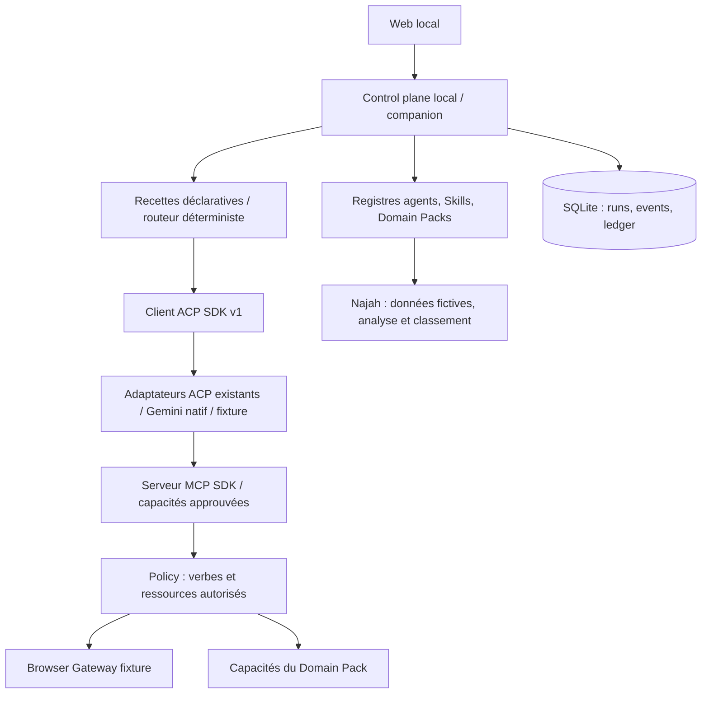
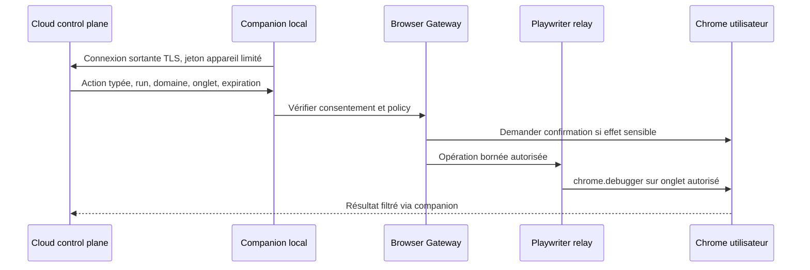

# Architecture — MVP local BYOA

Un seul processus HTTP local sert l'interface et orchestre. SQLite conserve runs, événements, Skills et usage. Un processus ACP par run, un serveur MCP stdio approuvé par session. Pas de microservices, Redis, cloud ni dépendance Najah dans le runtime.

Les Domain Packs déclarent des recettes, Skills, outils et validation de sortie. Le moteur sélectionne par mots-clés explicites en mode Auto ; ce n'est pas une planification LLM autonome. Le mode Auto de l'agent choisit un agent compatible uniquement lorsque le mode réel est activé, sinon le démonstrateur explicitement nommé.

Un Tool effectue une opération ; un Skill explique une méthode ; un Workflow ordonne des opérations ; un Agent exécute une tâche ; un Domain Pack distribue ces éléments. Skills embarqués revus, versions et SHA-256 enregistrés à l'installation, activation/désactivation ; scripts tiers non exécutés automatiquement.

## Contrats

- Runtime : probe, initialize, new/load, prompt, updates, cancel ; aucune API Najah.
- Session : identifiant fournisseur distinct du run, cwd stable ; reprise seulement si loadSession annoncé. Nouvelle tentative explicite, jamais relecture automatique d'actions mutantes.
- États : queued → running → waiting_permission → running → completed/failed/cancelled/interrupted. Redémarrage : runs non terminaux marqués interrupted, historique conservé.
- Événements : séquence persistée SQLite et SSE avec Last-Event-ID ; aucun rendu HTML des sorties agent.
- Usage : dimensions modèle externe, outils, workflow et navigateur ; quantité et montant plateforme en centimes EUR (devise fixe du MVP). Les dimensions détaillées navigateur/documents/infrastructure restent à instrumenter. Usage fournisseur inconnu reste null. Budget plateforme réservé avant travail, consommation BYOA non refacturée. Limite de temps et plafond d'événements pour bornes locales.

## Frontières de confiance

HTTP écoute seulement 127.0.0.1. Validation Host/Origin, mutations JSON avec en-tête applicatif contre CSRF, pas de CORS permissif. Pas de commande, chemin de serveur MCP ou cwd arbitraire reçu par HTTP. Sources Skills et packs locales approuvées par le développeur. Secrets fournisseurs restent dans les outils locaux et ne sont pas lus par l'API.

Les permissions ACP sont arbitrées hors prompt. Mode démonstration : actions sensibles refusées. Mode réel opt-in : demandes affichées, approbation ponctuelle explicite et expiration. Pas de allow_always ; fs/terminal délégués au client non annoncés. **ACP ne constitue pas un sandbox OS** : un CLI peut avoir des outils natifs, hooks, configurations ou permissions préexistantes. Mode réel réservé à l'utilisateur local de confiance ; ne pas accueillir de tâches ou Skills non fiables avant isolation OS et maîtrise des configurations natives. La passerelle MCP MVP ne fournit aucune capacité d'envoi d'e-mail ou candidature.

## Navigateur et cloud futurs

Ce circuit cloud/Playwriter est **prévu, non implémenté**. Le fournisseur browser fixture implémenté n'a pas de réseau et n'ouvre pas Chrome. Un véritable gateway devra vérifier domaine après redirection, sous-ressources, fichiers et consentement par onglet ; ne jamais offrir un outil JavaScript arbitraire au Domain Pack.

## Évolution multi-utilisateurs

Ajouter authentification, tenant_id partout, chiffrement/secrets, quotas transactionnels par tenant, workers isolés et rétention/redaction. Séparer le companion du serveur après authentification appareil. Managed réutilisera contrats, packs, registry et ledger, avec un runtime API distinct. acpx/flows à réévaluer avant reprise durable/parallélisme/DAG ; notre recette séquentielle n'est pas un moteur distribué.
