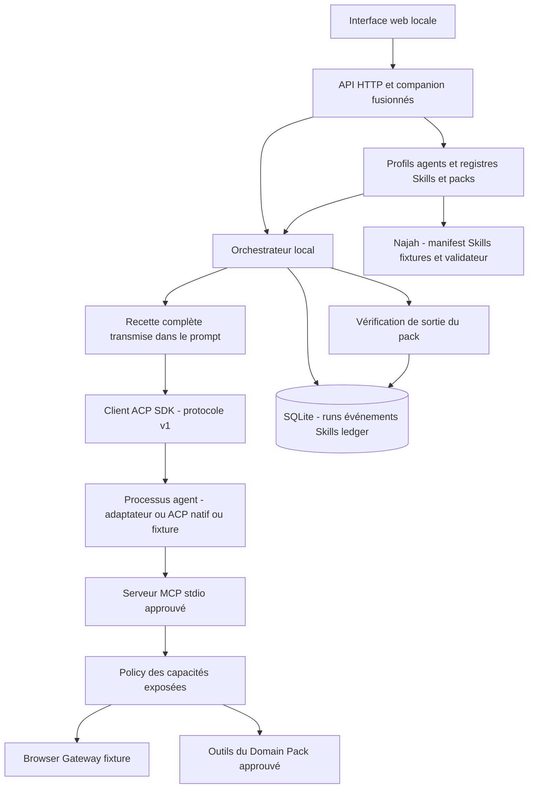
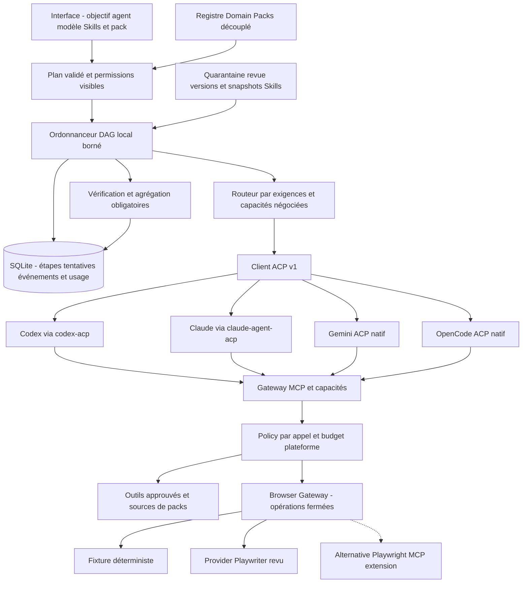
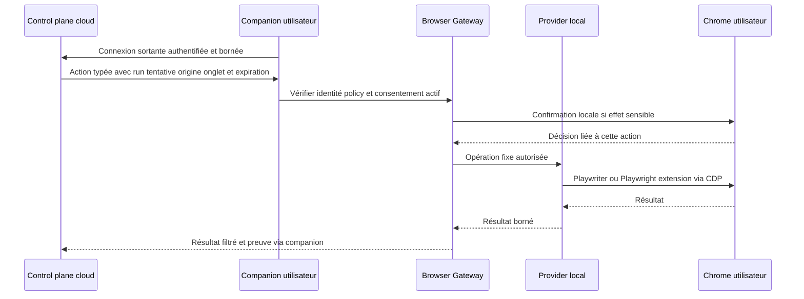

# Architecture — monolithe local BYOA et évolution contrôlée

Mise à jour : sprint 01, 25 octobre 2026. [Audit des 27 dépôts](open-source-research.md), [runtime/workflows](adr/003-runtime-and-durable-workflows.md), [navigateur/Skills](adr/004-browser-and-skill-boundaries.md), [conditions BYOA](adr/005-byoa-provider-terms.md).

## État effectivement implémenté

Un processus HTTP **127.0.0.1** sert l’interface, orchestre et joue le rôle du companion local. SQLite conserve runs, événements SSE, Skills installés et ledger. Un processus ACP par run et une configuration MCP approuvée par session ; aucune dépendance Najah dans le runtime. Les adaptateurs Codex/Claude sont optionnels et épinglés ; Gemini/OpenCode ont des profils de lancement, dont les capacités ne sont pas encore complètement normalisées.

Ce diagramme **ne représente pas un DAG déjà imposé par le moteur**. `packages/orchestrator/index.js` prépare des étapes affichables, mais remet la recette entière à `runtime.prompt()`. Le moteur impose l’état global, les permissions qu’il reçoit et la vérification finale, pas l’ordre réel des appels outils de l’agent. Les tests fixture exécutent la recette ; cela ne prouve pas qu’un agent fournisseur respectera le workflow.

Les packs regroupent manifest, Skills, outils et validation. Auto sélectionne par mots-clés pour le pack et par ordre de disponibilité pour l’agent en mode réel. Il ne fait pas encore de routage par exigences/capacités ; son repli actuel vers la fixture doit être rendu explicite au sprint 02.

## Contrats et invariants

Un **Tool** effectue une opération ; un **Skill** décrit une méthode ; un **Workflow** exprime dépendances et validations ; un **Agent** conduit une session de tâche ; un **Domain Pack** distribue ces éléments sans prendre le contrôle du runtime. Le fournisseur de modèle et l’agent sont deux identités distinctes, particulièrement dans OpenCode.

| Contrat | Implémenté | Écart ou règle de la cible |
|---|---|---|
| Runtime | detect, initialize, new/load, prompt, update, cancel ; SDK ACP officiel | Capacités live par version, aucun parsing terminal dans le chemin principal ; modèles Gemini à normaliser |
| Session fournisseur | sessionId distinct du run, cwd stable ; load uniquement annoncé | Recharger une conversation n’est pas reprendre une étape métier ; même session ne permet pas deux tours concurrents non négociés |
| Exécution | queued → running / waiting_permission → completed/failed/cancelled/interrupted | États par étape/tentative, admission atomique et génération à ajouter au sprint 03 |
| Événements | Séquences SQLite et SSE avec Last-Event-ID, affichage texte | Associer source/version/étape, ignorer les sorties tardives d’une tentative révoquée |
| Skills | Embarqués revus, empreinte SKILL.md, activation/désactivation | Hash de tous les fichiers, provenance/version immuable, quarantaine et export par agent au sprint 05 |
| MCP | Stdio SDK réel, serveur local approuvé, paramètres validés | Allowlist de serveurs/outils et contrôles par appel ; négocier HTTP/SSE, ne pas suivre le HEAD SDK alpha automatiquement |
| Navigateur | Provider fixture, aucun Chrome ni réseau | Gateway typé et contrôle d’effet avant provider réel ; aucun JS arbitraire pour un pack |
| Usage | Ledger par dimension, coût plateforme EUR en centimes, budget vérifié avant inscription | Valeurs fournisseur optionnelles/cumulatives à normaliser sans les refacturer ; coûts inconnus restent null |

Écart de timeout découvert pendant l’audit : le runtime passe `signal` au SDK qui attend `cancellationSignal` ; son timeout de requête individuel n’est donc pas effectif. Le timeout global de l’orchestrateur ferme le processus, mais ne remplace pas une deadline correcte par requête (priorité sprint 02). Le script d’audit a été corrigé et testé avec un pair qui ne répond jamais.

Les limites de temps et de nombre d’événements réduisent les ressources locales ; elles ne garantissent pas l’arrêt d’un débit fournisseur à un montant donné. Le ledger actuel est auditable localement, pas inviolable face au propriétaire du disque. Les dimensions navigateur/documents/données/infra ne sont pas toutes instrumentées.

## Cible des sprints 02–05 — prévue

L’ordonnanceur exécute lui-même les dépendances, le fan-out/fan-in borné et la vérification finale. Il persiste l’entrée et le résultat des tentatives, refuse les publications d’une génération annulée et distingue résultat connu, échec et effet externe incertain. Reprise explicite des étapes idempotentes ; réconciliation ou décision humaine pour un effet ambigu. Ne pas promettre exactly-once aux actions navigateur ou aux prompts déjà facturés.

**Pas d’adoption automatique d’acpx flows.** Le code inspecté parcourt un seul nœud courant et ses traces ne démontrent pas la reprise durable d’un DAG. Son runtime reste candidat si pooling/reconnexion justifient la double gestion de sessions. CAO inspire journaux/plafonds/récupération mais ne fournit pas encore le parallélisme inspecté. DBOS fournit une vraie reprise, au prix de PostgreSQL : à réévaluer lors du changement de stockage, sans ajouter une seconde base pour le MVP.

## Frontières de confiance

Le serveur local vérifie Host/Origin et exige des mutations JSON avec en-tête applicatif. Aucun chemin de commande, serveur MCP ou cwd arbitraire n’est accepté par HTTP. Seuls les packs locaux explicitement approuvés sont chargés comme code. Ne pas présenter cela comme une plateforme multi-utilisateurs isolée.

Les permissions ACP sont arbitrées hors prompt, avec décision ponctuelle, expiration et annulation. `allow_always` est filtré ; fs/terminal client ne sont pas annoncés. **Les outils natifs, configurations, hooks et MCP propres au CLI restent en dehors de cette garantie** : désactiver le proxy fs ACP ne retire pas les accès OS du CLI. Les profils natifs Gemini/OpenCode devront donc choisir un mode annoncé et gérer leurs configurations effectives avant exposition à des tâches non fiables. Le mode réel demeure réservé au propriétaire local de confiance.

Le gateway de capacités doit appliquer ses propres décisions, indépendamment des demandes que l’agent choisit d’émettre. Les annotations MCP et `allowed-tools` de SKILL.md restent des indications, jamais des droits accordés. Contenu web, sorties outils et Skills tiers ne peuvent pas élargir les permissions. L’import de Skill ne doit exécuter aucun script, écrire dans les configurations globales ou activer une version sans revue.

Les identifiants des fournisseurs restent dans leurs mécanismes officiels. La plateforme ne doit pas réutiliser OAuth pour appeler un endpoint abonnement directement. Compatibilité technique, contrat d’utilisation et droit de redistribution sont des champs distincts ; [ADR 005](adr/005-byoa-provider-terms.md) précise les limites connues.

## Navigateur et companion distant — non implémentés

Playwriter **et** Playwright MCP extension peuvent conduire Chrome utilisateur. Le choix initial de provider ne doit pas apparaître dans les workflows Najah. Le consentement de connexion n’est pas une permission d’envoyer, téléverser ou candidater. Revalider l’origine après redirection et avant action, contrôler popups/onglets, fichiers et extractions ; l’interception réseau du provider est une défense complémentaire à vérifier, pas une garantie universelle. Ne pas exporter cookies ni secrets de session au cloud.

## Critique de l’architecture cible de la mission

Les couches de la mission sont des responsabilités utiles, **pas des services à déployer séparément**. Intent Router, Planner, Session Manager, Capability Registry, Policy et Usage peuvent rester des modules du même processus et du même SQLite. Séparer « agent choisi » et « modèle annoncé », « session fournisseur » et « tentative workflow », « permission de connexion » et « permission d’effet » est plus important à ce stade que multiplier les packages vides.

Le Domain Pack Registry reste indépendant du runtime ; Najah n’est qu’un pack et ses fixtures restent identifiées. Les capacités doivent être adressées par contrat stable, avec provider remplaçable. Les budgets plateforme et la consommation fournisseur sont mesurés séparément.

La cible commerciale multi-utilisateurs reste **prévue** : authentification, tenant_id dans toutes les clés/événements/permissions/ledger, isolation OS/worker par utilisateur, contrôle des configurations natives, chiffrement/rétention/redaction, quotas transactionnels et authentification appareil. Préparer les contrats maintenant ; ne pas déclarer le MVP prêt SaaS. Lorsqu’un besoin multi-worker existe, évaluer PostgreSQL + DBOS et un gateway comme agentgateway, puis valider les licences et conditions du montage exact. Managed réutilisera packs/contrats/ledger, avec un runtime API et un contrat fournisseur distincts.
