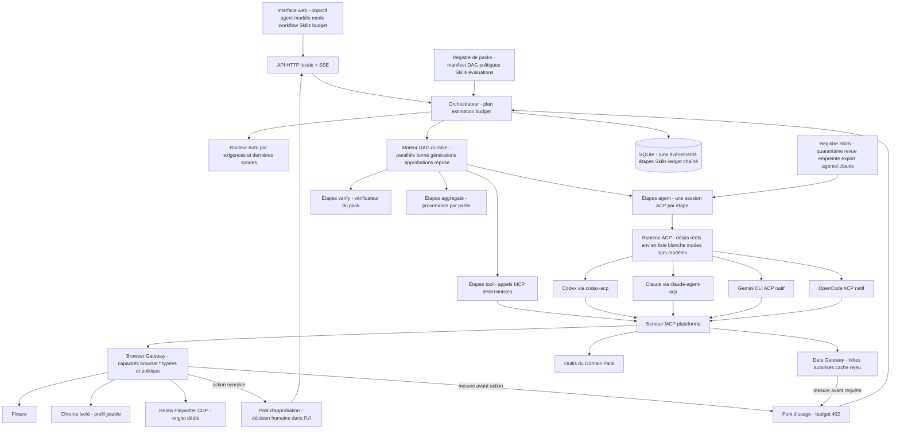
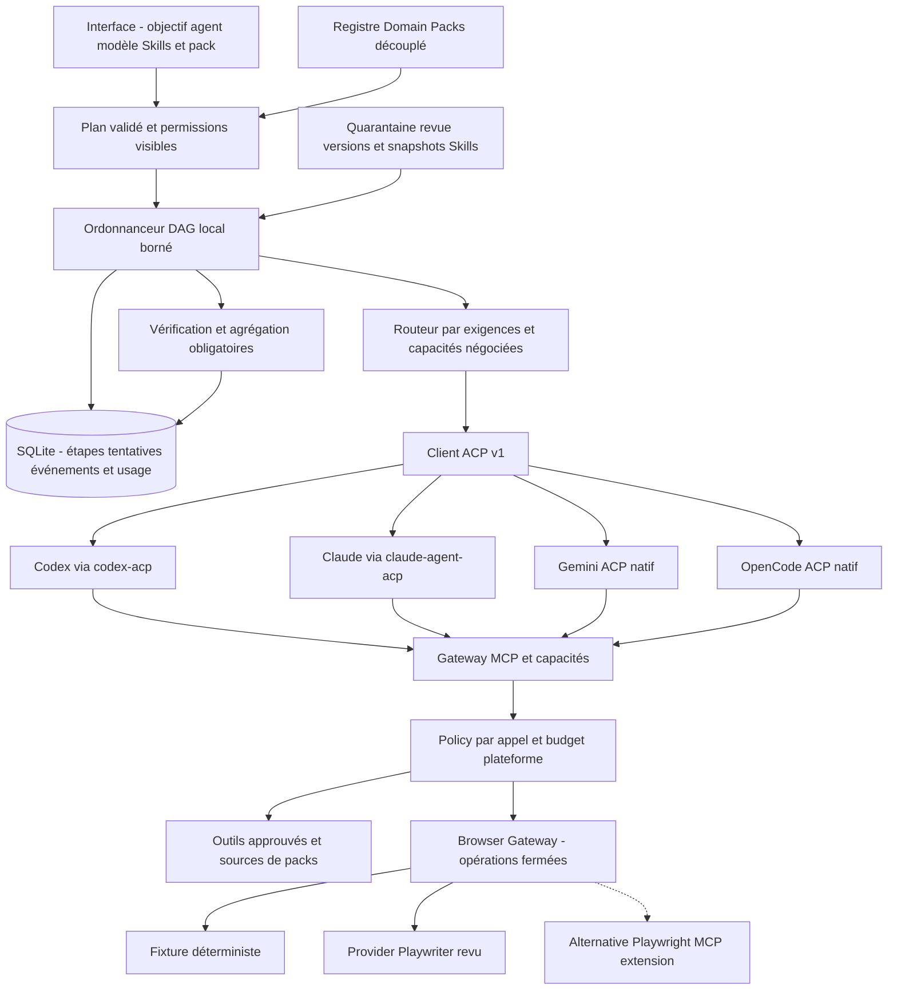
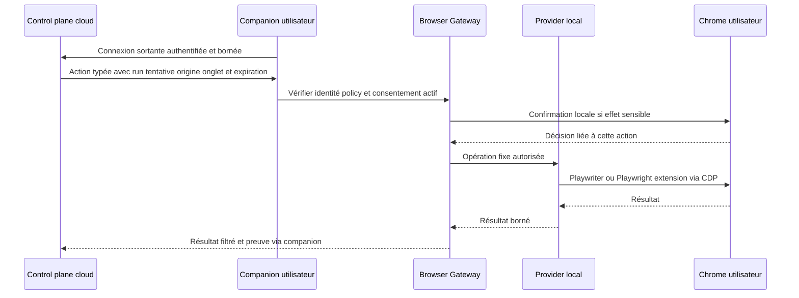

# Architecture — monolithe local BYOA et évolution contrôlée

Mise à jour : sprint 01, puis sprints 02–08 (manager), 25 octobre 2026. [Audit des 27 dépôts](open-source-research.md), [runtime/workflows](adr/003-runtime-and-durable-workflows.md), [navigateur/Skills](adr/004-browser-and-skill-boundaries.md), [conditions BYOA](adr/005-byoa-provider-terms.md).

## État effectivement implémenté (25 octobre 2026, après les sprints 02 à 08)

Un processus HTTP **127.0.0.1** sert l'interface, orchestre et joue le rôle du companion local. Un seul
SQLite conserve runs, événements SSE, étapes de workflow, Skills et ledger chaîné. Les composants de la
mission sont des **modules** d'un même processus, pas des services.

| Contrat | Implémenté et testé | Limites restantes |
|---|---|---|
| Runtime ACP | Délais par méthode, crash → `AgentExitError`, réponses tardives ignorées, env en liste blanche, secrets masqués, mode sûr parmi les modes annoncés, modèles via `configOptions` ou `session/set_model` | Reprise `session/load` réelle non prouvée ; Claude sans authentification ici |
| Routeur Auto | Exigences (modèle, reprise, transport MCP) × détection × dernières sondes, rejets expliqués, aucun repli fixture silencieux | Pas encore de score coût/latence |
| Workflows | DAG validé (cycles, dépendances), parallèle borné, tentatives, générations, `uncertain` pour effets interrompus, approbations, reprise en place après crash, multi-agent par étape, `$from` | Le planificateur choisit un DAG déclaré par le pack ; pas de génération de DAG par LLM |
| Skills | Analyse statique, quarantaine, revue liée à l'empreinte, versions, intégrité, export natif, import GitHub | Pas de signature ; permissions déclarées par Skill non croisées |
| Navigateur | 7 capacités, politique (domaines, SSRF/DNS, redirections, fichiers), sensible → humain, Chrome isolé testé réellement, CDP partagé testé | Extension Playwriter non testée ; heuristique de sensibilité |
| Données | Data Gateway (HTTPS, hôtes du pack, DNS, redirections, taille, cache, rejeu) | Une source primaire de sponsoring (UK) seulement |
| Usage | Mètres séparés, BYOA jamais facturé, ledger chaîné, budget run + plafond mensuel, mesure avant action, estimation par étape | Pas d'abonnements/crédits ; pas d'ancrage externe du ledger |

**Vocabulaire.** Un **Tool** effectue une opération (outil MCP, capacité `browser.*`) ; un **Skill** décrit une
méthode (SKILL.md) ; un **Workflow** exprime dépendances, approbations et vérifications (DAG du pack) ; un
**Agent** conduit une session ACP pour une étape ; un **Domain Pack** distribue Skills, DAG, outils,
politiques et évaluations sans jamais prendre le contrôle du runtime. Le fournisseur de modèle et l'agent
sont deux identités distinctes.

Le diagramme et le tableau de la section suivante décrivaient la cible des sprints 02–05 rédigée au
sprint 01 ; ils sont conservés pour la traçabilité des décisions.

## Cible des sprints 02–05 (rédigée au sprint 01) — désormais largement réalisée

L’ordonnanceur exécute lui-même les dépendances, le fan-out/fan-in borné et la vérification finale. Il persiste l’entrée et le résultat des tentatives, refuse les publications d’une génération annulée et distingue résultat connu, échec et effet externe incertain. Reprise explicite des étapes idempotentes ; réconciliation ou décision humaine pour un effet ambigu. Ne pas promettre exactly-once aux actions navigateur ou aux prompts déjà facturés.

**Pas d’adoption automatique d’acpx flows.** Le code inspecté parcourt un seul nœud courant et ses traces ne démontrent pas la reprise durable d’un DAG. Son runtime reste candidat si pooling/reconnexion justifient la double gestion de sessions. CAO inspire journaux/plafonds/récupération mais ne fournit pas encore le parallélisme inspecté. DBOS fournit une vraie reprise, au prix de PostgreSQL : à réévaluer lors du changement de stockage, sans ajouter une seconde base pour le MVP.

## Frontières de confiance

Le serveur local vérifie Host/Origin et exige des mutations JSON avec en-tête applicatif. Aucun chemin de commande, serveur MCP ou cwd arbitraire n’est accepté par HTTP. Seuls les packs locaux explicitement approuvés sont chargés comme code. Ne pas présenter cela comme une plateforme multi-utilisateurs isolée.

Les permissions ACP sont arbitrées hors prompt, avec décision ponctuelle, expiration et annulation. `allow_always` est filtré ; fs/terminal client ne sont pas annoncés. **Les outils natifs, configurations, hooks et MCP propres au CLI restent en dehors de cette garantie** : désactiver le proxy fs ACP ne retire pas les accès OS du CLI. Les profils natifs Gemini/OpenCode devront donc choisir un mode annoncé et gérer leurs configurations effectives avant exposition à des tâches non fiables. Le mode réel demeure réservé au propriétaire local de confiance.

Le gateway de capacités doit appliquer ses propres décisions, indépendamment des demandes que l’agent choisit d’émettre. Les annotations MCP et `allowed-tools` de SKILL.md restent des indications, jamais des droits accordés. Contenu web, sorties outils et Skills tiers ne peuvent pas élargir les permissions. L’import de Skill ne doit exécuter aucun script, écrire dans les configurations globales ou activer une version sans revue.

Les identifiants des fournisseurs restent dans leurs mécanismes officiels. La plateforme ne doit pas réutiliser OAuth pour appeler un endpoint abonnement directement. Compatibilité technique, contrat d’utilisation et droit de redistribution sont des champs distincts ; [ADR 005](adr/005-byoa-provider-terms.md) précise les limites connues.

## Companion distant (cloud) — non implémenté ; navigateur local implémenté (ADR 006)

Playwriter **et** Playwright MCP extension peuvent conduire Chrome utilisateur. Le choix initial de provider ne doit pas apparaître dans les workflows Najah. Le consentement de connexion n’est pas une permission d’envoyer, téléverser ou candidater. Revalider l’origine après redirection et avant action, contrôler popups/onglets, fichiers et extractions ; l’interception réseau du provider est une défense complémentaire à vérifier, pas une garantie universelle. Ne pas exporter cookies ni secrets de session au cloud.

## Critique de l’architecture cible de la mission

Les couches de la mission sont des responsabilités utiles, **pas des services à déployer séparément**. Intent Router, Planner, Session Manager, Capability Registry, Policy et Usage peuvent rester des modules du même processus et du même SQLite. Séparer « agent choisi » et « modèle annoncé », « session fournisseur » et « tentative workflow », « permission de connexion » et « permission d’effet » est plus important à ce stade que multiplier les packages vides.

Le Domain Pack Registry reste indépendant du runtime ; Najah n’est qu’un pack et ses fixtures restent identifiées. Les capacités doivent être adressées par contrat stable, avec provider remplaçable. Les budgets plateforme et la consommation fournisseur sont mesurés séparément.

La cible commerciale multi-utilisateurs reste **prévue** : authentification, tenant_id dans toutes les clés/événements/permissions/ledger, isolation OS/worker par utilisateur, contrôle des configurations natives, chiffrement/rétention/redaction, quotas transactionnels et authentification appareil. Préparer les contrats maintenant ; ne pas déclarer le MVP prêt SaaS. Lorsqu’un besoin multi-worker existe, évaluer PostgreSQL + DBOS et un gateway comme agentgateway, puis valider les licences et conditions du montage exact. Managed réutilisera packs/contrats/ledger, avec un runtime API et un contrat fournisseur distincts.
