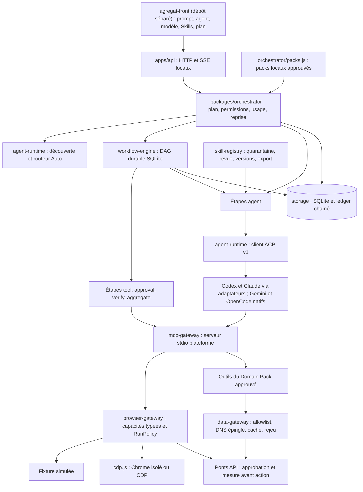
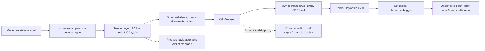
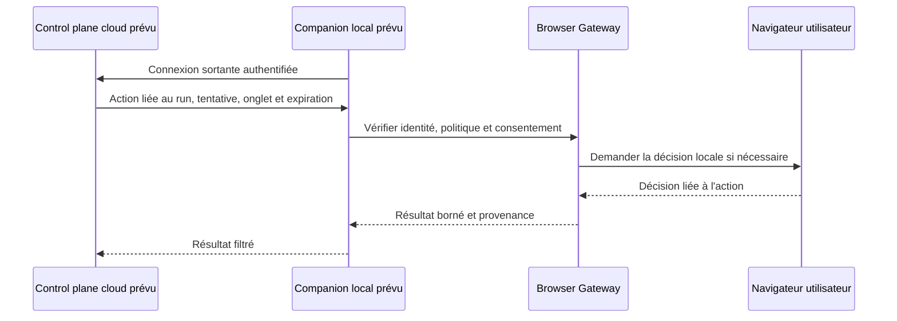

# Architecture — monolithe local BYOA

État du code au **26 octobre 2026**, vérifié pour docs-01. Les preuves renouvelées et leurs limites sont dans
[le rapport](../.manager/reports/docs-01.md). Le produit est local et mono-utilisateur ; Managed et SaaS restent prévus.

## Modules et exécution existants

Un processus HTTP sur `127.0.0.1` sert l'API et l'orchestration. Le diagnostic CLI est dans
`apps/companion` ; aucun companion distant n'est déployé. Un SQLite conserve runs, événements, étapes,
Skills et ledger. Les agents et le serveur MCP stdio sont des processus enfants.

| Contrat | Implémentation et preuves | Limite |
|---|---|---|
| ACP | `agent-runtime`, `tests/runtime.test.js` : sessions, streaming, modèles annoncés, modes, timeout, crash, annulation et reprise | Fournisseurs réels : preuves historiques ; authentification et inférence non renouvelées par docs-01 |
| Auto | Détection × exigences × dernières sondes, rejets expliqués (`tests/api-agents.test.js`) | Pas de score coût/latence ; détection ne prouve pas l'accès fournisseur |
| DAG | Parallèle borné, générations, tentatives, reprise et effets incertains (`tests/workflow-engine.test.js`, `tests/workflow-resume.test.js`) | Choix de DAG déclarés, aucune génération de DAG par modèle ; pas de garantie exactly-once des effets externes |
| Skills | Quarantaine, revue liée au hash, intégrité et export natif (`tests/skill-registry.test.js`) | Permissions déclaratives sans sandbox OS ; pas de signature de catalogue |
| Navigateur sécurisé | `BrowserGateway`, `RunPolicy`, Chrome isolé et CDP temporaire ; tests Chrome, ponts et erreurs | Playwriter 0.7.0 refusé avant attachement ; canal humain local non isolé d'un CLI du même compte |
| Données Najah | Arbeitnow, Remotive, registre UK via Data Gateway ; rejeu testé dans `tests/najah-live.test.js` | **Sponsoring multi-pays PRÉVU** : aucune source NL/IE, aucun test livré ; correspondance UK de nom seulement |
| Usage | `billing` + `storage` : mètres, tarifs, budgets, plafond mensuel, ledger (`tests/billing.test.js`) | Tarifs à zéro par défaut, coût fournisseur inconnu, BYOA jamais refacturé ; exceptions propriétaire ci-dessous |

## ACP, MCP et objets métier : responsabilités distinctes

- **ACP** relie le client plateforme à l'agent : initialisation, session, prompt, événements, modèles,
  permissions et annulation. SDK `@agentclientprotocol/sdk` 2.0.2, protocole v1.
- **MCP** relie les agents (ou étapes déterministes) aux outils : découverte et appels stdio du serveur
  plateforme (`@modelcontextprotocol/sdk` 1.32.2). Les services MCP externes arbitraires restent incomplets.
- Un **Tool** effectue une opération, par exemple `browser_navigate`, correspondant au contrat `browser.navigate`.
- Un **Skill** fournit une méthode dans `SKILL.md`, sans devenir une autorisation d'exécuter du code.
- Un **Workflow** décrit dépendances, étapes et vérification. Le moteur exécute les DAG déclarés des packs.
- Un **Agent** conduit une session ACP ; son runtime et son modèle sont deux choix distincts.
- Un **Domain Pack** distribue manifest, Skills, DAG, outils, politiques et évaluations. Seuls les packs
  locaux approuvés par `packages/orchestrator/packs.js` sont chargés comme code ; Najah ne contrôle pas le runtime.

## Mode propriétaire local : chemin distinct et explicite

`AGENT_PLATFORM_OWNER_MODE=1` active le live et impose l'écoute `127.0.0.1`. Il force le fournisseur
Playwriter, JavaScript et contexte partagé, accorde les sept capacités navigateur, supprime les décisions
sur écritures/sensibilité et auto-approuve les permissions ACP (sauf annulation). Les tarifs plateforme
sont remis à zéro et le plafond mensuel retiré ; les compteurs et le ledger continuent. Les modes ACP
sont choisis parmi ceux annoncés : Codex `workspace-write`, Claude `bypassPermissions` puis alternatives,
Gemini `yolo` puis alternatives, OpenCode `build` (voir [ADR 008](adr/008-local-owner-mode.md)).

Le provider `playwriter-owner` désigne le Chrome de l'utilisateur connecté ; `cdp-isolated-fallback` désigne un profil vierge, non connecté à ses comptes.

`browser-agent` est un parcours d'agent construit par l'orchestrateur, **pas un DAG YAML durable**.
Il est choisi en propriétaire pour le pack hors Najah et un workflow absent, `auto` ou `browser-agent` ;
ce n'est pas une classification sémantique des seuls prompts « va sur ». Le proxy crée une cible marquée,
filtre sessions/événements/inventaire, simule l'auto-attachement au client et refuse les commandes globales
comme `Browser.close` et `Browser.setDownloadBehavior`. Il ne donne pas accès aux onglets préexistants
via ce client. Cela ne constitue pas une sandbox d'un CLI natif.

Les gardes réseau du provider sont désactivées en propriétaire : navigation et ressources passent par Chrome,
avec scripts, workers et cookies du profil partagé. Les vérifications d'URL à l'entrée de la gateway,
les schémas et les chemins de fichiers persistent ; **elles ne garantissent pas le filtrage de toutes les
sous-ressources ou redirections de Chrome**. Voir `tests/owner-mode.test.js`, `tests/owner-browser.test.js`,
`tests/owner-transport.test.js` et la preuve réelle historique du 25/10 dans le rapport owner-mode-01.

## Frontières de confiance du mode sécurisé

Host/Origin sont contrôlés, les mutations exigent un en-tête applicatif. Aucun cwd, commande ou serveur
MCP arbitraire n'est choisi par HTTP. Les permissions ACP sont ponctuelles, expirent et sont annulées avec
le run. Fs/terminal client ne sont pas annoncés ; les outils natifs/hooks/configurations des CLI restent
hors de ce contrôle et conservent leurs droits OS.

La gateway impose les décisions hors prompt. JavaScript et partage du contexte sont désactivés par défaut ;
chaque exception exige son consentement par run. Le mode sécurisé exige le bypass des workers par CDP pour
une page partagée ; routage/CSP seuls ont été prouvés insuffisants. Les redirections sont contrôlées, y compris
le chemin final de même origine (correctif `a299199`). Les contenus web et Skills tiers restent non fiables.
Le canal HTTP de décision n'authentifie pas une personne contre un programme natif local : protection
multi-utilisateurs **incomplète**, même hors propriétaire. Détails : [ADR 006](adr/006-browser-gateway.md).

## Évolution prévue : companion distant

Cette connexion cloud n'existe pas dans le MVP. Avant SaaS : authentification, tenant dans toutes les clés,
isolation OS/réseau, canal humain protégé, rétention/chiffrement et authentification appareil. PostgreSQL,
DBOS et agentgateway restent des candidats, sans dépendance ajoutée. Managed nécessite un runtime API et
un contrat fournisseur distincts ; voir l'[audit](open-source-research.md) et l'[ADR 005](adr/005-byoa-provider-terms.md).
