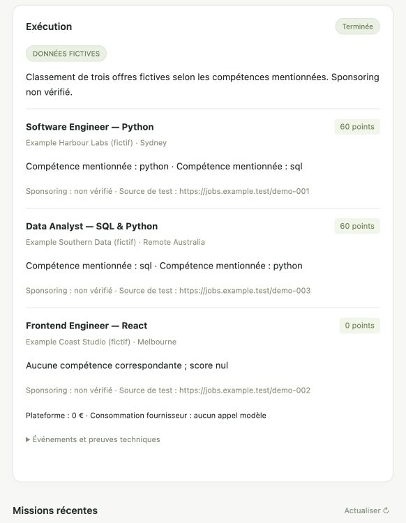

# Validation — 24 octobre 2026

## Environnement

Dossier de départ vide, aucune convention de dépôt préexistante détectée. macOS, Node v24.14.1, npm 11.11.0. CLI personnel Codex 0.163.0, Claude Code 2.1.207. Gemini et OpenCode absents.

Attention : `npm run` ajoute node_modules/.bin au PATH. Le premier essai utilisait ainsi le Codex transitif de l'adaptateur. Correctif : la détection exclut node_modules, sélectionne l'exécutable personnel absolu et le transmet explicitement à l'adaptateur. Test réel répété avec **Codex 0.163.0**, réussi.

## Résultats reproductibles

- `npm test` : **10 tests réussis**, aucun ignoré. Aucun appel modèle dans cette suite.
- `npm run check` : syntaxe JavaScript valide.
- `npm run format:check` : style vérifié avec Prettier verrouillé.
- `npm run demo` : session ACP fixture → MCP stdio → trois offres fictives classées → validation de sortie → état completed.
- `npm audit` après correction Zod 4.6.7 / YAML 2.9.1 : **0 vulnérabilité signalée**. Ne remplace pas un audit sécurité du produit.

Couverture : règles navigateur/domaine, refus d'actions mutantes, budget et rollback transactionnel, intégrité/désactivation des Skills, durabilité et récupération après interruption, découverte/appel MCP, API HTTP et CSRF/Host, événements SSE avec curseur, indépendance du pack général, annulation/timeout, permissions ponctuelles et reprise non supportée. Le test Host utilise http.get car fetch remplace l'en-tête Host forgé.

## Agents réels

Rapport détaillé : [live-probe.json](research/live-probe.json).

| Agent | Handshake | Session | Prompt réel |
|---|---|---|---|
| Codex personnel 0.163.0 | Réussi | Réussie, mode read-only | Réponse « OK », stopReason end_turn |
| Claude Code 2.1.207 | Réussi | Réussie, mode default | Échec explicite : Authentication required |
| Gemini CLI | Non testé | Non testé | CLI absent |
| OpenCode | Non testé | Non testé | CLI absent |

Le test réel ne demande aucun outil, fichier, e-mail ou candidature. Les modèles et capacités proviennent du handshake, pas d'une liste inventée. La reprise loadSession est implémentée et annoncée par Codex/Claude mais **non testée de bout en bout avec un fournisseur réel**. Le workflow Najah complet avec modèle réel et demandes de permissions interactives reste à valider après configuration utilisateur ; sa variante fixture est testée intégralement.

## Vérification interface

Dans le navigateur intégré : installation et sélection des deux Skills, préparation du plan, lancement de Najah, affichage de l'état Terminée, trois résultats avec scores 60/60/0, mention DONNÉES FICTIVES et coût plateforme nul. Interface observée sur panneau étroit ; mise en page responsive vérifiée visuellement dans ce contexte. Capture :

## Blocages et limites concrètes

- Le bac à sable initial refusait DNS réseau, écoute loopback et initialisation SQLite de Codex dans son répertoire personnel. Les commandes nécessaires ont été relancées avec les permissions d'exécution appropriées ; ces blocages sont levés pour la validation.
- Claude : authentification non utilisable dans l'adaptateur. Aucune lecture/copie manuelle de credentials ni contournement effectué.
- Playwriter/extension : non installés ni connectés dans le produit. Le gateway utilise une fixture sans navigateur réel, comme autorisé dans le cahier des charges.
- Pas de recherche d'offres réelles, de visa ou d'employeur vérifié. Le sponsoring reste inconnu dans toutes les fixtures.
- Pas de facturation, de budget fournisseur garanti, de Managed ou de cloud multi-tenant. Les coûts fournisseurs non fournis restent inconnus ; le ledger ne les refacture pas.
- Pas de sandbox OS universel, validation exhaustive des CLI, scanner de Skills tiers ni audit formel des dépendances. Permissions ACP et restriction MCP ne contrôlent pas toutes les capacités natives d'un agent local.
- Le ledger distingue le workflow, les appels outils observés et les tours BYOA ; métriques détaillées navigateur/documents/infrastructure et tarifs futurs restent à instrumenter. Les événements outils annoncés par l'agent ne sont pas une preuve de facturation tierce.

## Complément sprint 01 — 25 octobre 2026

Le contexte et les probes du 24 octobre ci-dessus restent historiques. Ce sprint ne relance ni authentification ni prompt fournisseur. Les dépendances produit et le code métier/runtime restent inchangés ; ajout de scripts d’audit et de documents.

- Base : **10/10 tests**. Suite finale après ajout du test de probe muet : `npm test` **11/11** (20,80 s), `npm run check`, `npm run format:check` et `git diff --check` réussis. Le nouveau test utilise deux faux CLI marqués FICTIF et attend la vraie deadline de 20 s ; aucun modèle/service payant. Les tests métier existants restent inchangés.
- Audit source local des 22 clones initiaux + 4 complémentaires + career-ops ajouté par le manager : [étude complète et limites](open-source-research.md), [inventaire reproductible](research/sprint-01-inventory.json), [index des lectures et empreintes](research/sprint-01-code-index.json).
- Versions réellement installées en répertoire temporaire : Gemini **0.65.0**, OpenCode **1.19.4**. Installation globale tentée, refus OS **EACCES** sur `/usr/local`, sans contournement ni changement de configuration globale.
- [Probe isolé](research/sprint-01-acp-probe.json), via `scripts/acp-audit-probe.js` : configurations temporaires, sans clés héritées, aucune méthode authenticate/prompt, aucun MCP externe. Gemini : handshake ACP v1 réussi ; session/new **refusée -32000** faute de clé. OpenCode : handshake et session/new réussis ; catalogue modèle/mode seulement, sans preuve d’accès inférence.
- Les versions sources HEAD diffèrent des CLI publiés : OpenCode 2.1.4 **refuse SSE** dans le code, publié 1.19.4 annonce **SSE=true**. Codex HEAD déclare 2.2.2 mais son gitHead diffère du paquet Relay : ne pas transférer les capacités HEAD à la distribution. Métadonnées : [sprint-01-packages.json](research/sprint-01-packages.json).
- Processus des probes arrêtés, absence de processus résiduel vérifiée avec `ps` après escalade (aucune correspondance aux chemins temporaires). OpenCode imposé sur 127.0.0.1 ; aucune extension Chrome, aucun outil d’envoi ni candidature utilisé.
- Playwriter et Playwright MCP extension : code inspecté, **aucun navigateur réel testé**. Le workflow durable parallèle et les nouveaux profils normalisés restent prévus (ADR 003–004).

Le rapport du sprint contient les erreurs de repérage, refus sandbox/installation et la trace des vérifications/commits : `.manager/reports/sprint-01.md`. Les CGU consultées sont analysées dans l’[ADR 005](adr/005-byoa-provider-terms.md) ; un handshake réussi ne constitue pas une autorisation commerciale.

Le script de probe utilise désormais `cancellationSignal` et une deadline locale, validée face à un pair muet. Le runtime produit conserve un défaut préexistant (`signal` au lieu de `cancellationSignal`, timeout individuel inefficace) : constat documenté, correction prioritaire proposée au sprint 02. Son timeout global d’orchestrateur ferme les enfants ; ce n’est pas une preuve de deadline par requête.
